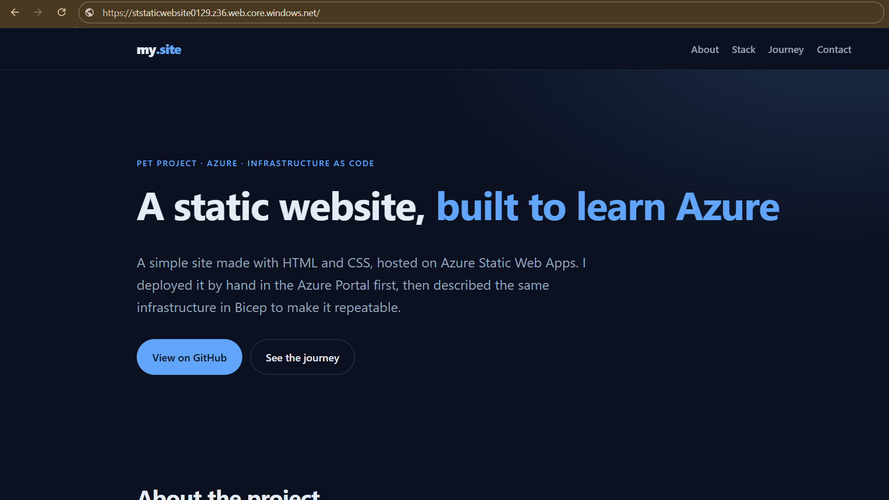
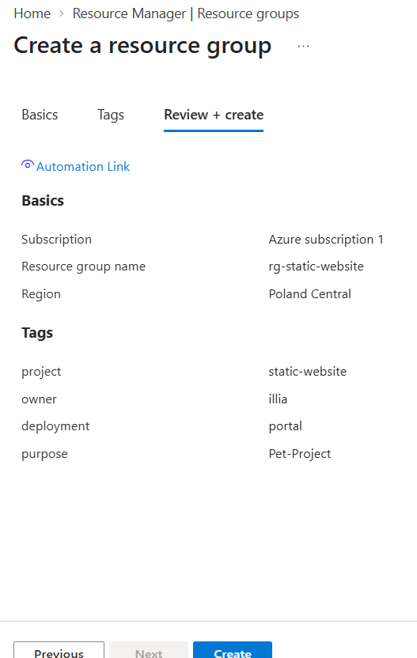
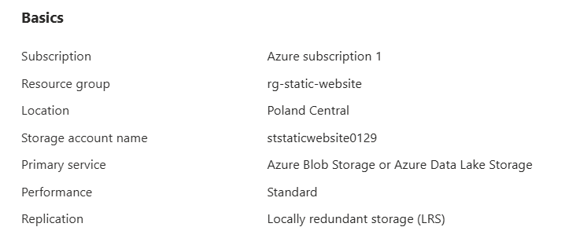
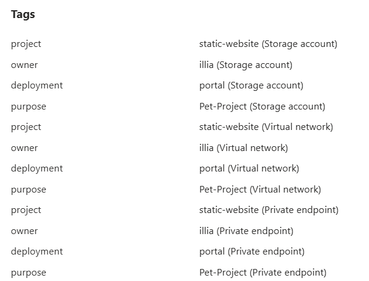
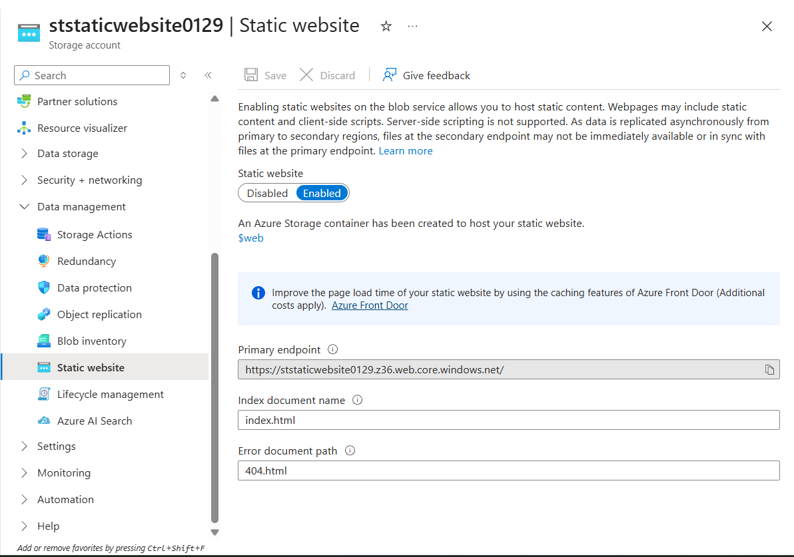
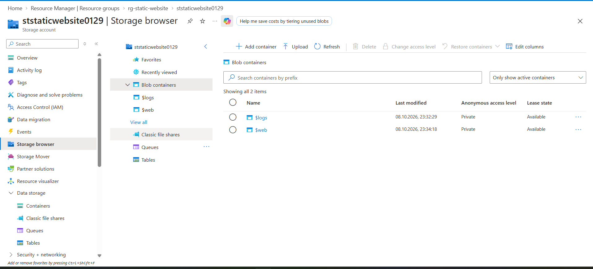
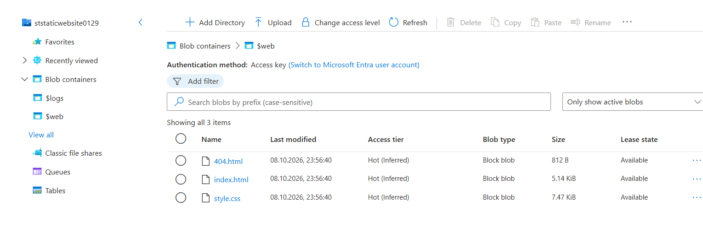
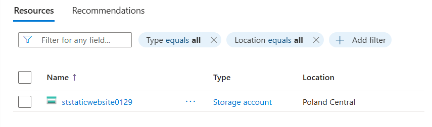

# Azure Static Website

A simple static website deployed to Microsoft Azure in three ways: **Azure Portal**, **Bicep** and **Terraform**.

The project was created as a practical exercise to learn Azure resource management, storage accounts, static website hosting, Infrastructure as Code and basic cloud deployment workflows.

🔗 **Live demo:** `https://ststaticwebsite0129.z36.web.core.windows.net/`



---

## Deployment methods

| Method           | Where to read                                                | When to use                                  |
| ---------------- | ------------------------------------------------------------ | -------------------------------------------- |
| **Azure Portal** | [below](#deployment-using-azure-portal)                      | First look at Azure, no tools needed         |
| **Bicep**        | [infrastructure/bicep/README.md](infrastructure/bicep/README.md)       | Azure-only Infrastructure as Code     |
| **Terraform**    | [infrastructure/terraform/README.md](infrastructure/terraform/README.md) | One tool for infrastructure and files |

Every method has a short "why" file next to it:

- Portal → [docs/portal-explained.md](docs/portal-explained.md)
- Bicep → [infrastructure/bicep/WHY.md](infrastructure/bicep/WHY.md)
- Terraform → [infrastructure/terraform/WHY.md](infrastructure/terraform/WHY.md)

> Use **one method at a time**. All methods create a resource group named `rg-static-website`, so delete the previous deployment before trying another one.

---

## Architecture

The project uses:

- **Azure Resource Group**
- **Azure Storage Account**
- **Static Website hosting**
- **Azure Blob Storage**

The website files are stored in the `$web` container provided by Azure Static Website hosting.

```text
Resource Group (rg-static-website)
└── Storage Account
    └── Static Website
        └── $web
            ├── index.html
            ├── style.css
            └── 404.html
```

---

## Project Structure

```text
azure-static-website/
│
├── src/
│   ├── index.html
│   ├── style.css
│   └── 404.html
│
├── infrastructure/
│   ├── bicep/
│   │   ├── main.bicep
│   │   ├── main.bicepparam
│   │   ├── README.md
│   │   └── WHY.md
│   │
│   └── terraform/
│       ├── main.tf
│       ├── variables.tf
│       ├── outputs.tf
│       ├── terraform.tfvars.example
│       ├── .terraform.lock.hcl
│       ├── README.md
│       └── WHY.md
│
├── docs/
│   ├── portal-explained.md
│   └── screenshots/
│
├── .gitignore
├── LICENSE
└── README.md
```

---

## Prerequisites

- An [Azure account](https://azure.microsoft.com/free/) (the free tier is enough)
- The website files from the `src/` folder

> Steps verified in October 2026. The Azure Portal UI may change slightly over time.

---

# Deployment using Azure Portal

Open the [Azure Portal](https://portal.azure.com/).

## Step 1 — Create a Resource Group

Search for **Resource groups** → click **Create**.

| Setting          | Value                  |
| ---------------- | ---------------------- |
| `Subscription`   | `Azure subscription 1` |
| `Resource group` | `rg-static-website`    |
| `Region`         | `West Europe`          |

Open the **Tags** tab and add:

| Name         | Value            |
| ------------ | ---------------- |
| `project`    | `static-website` |
| `owner`      | `illia`          |
| `deployment` | `portal`         |
| `purpose`    | `Pet-Project`    |

Click **Review + create**, then **Create**.



---

## Step 2 — Create a Storage Account

Search for **Storage accounts** → click **Create**.

| Setting                  | Value                                           |
| ------------------------ | ----------------------------------------------- |
| `Subscription`           | `Azure subscription 1`                          |
| `Resource group`         | `rg-static-website`                             |
| `Storage account name`   | `ststaticwebsite0129`                           |
| `Region`                 | `polandcentral`                                 |
| `Preferred storage type` | `Azure Blob Storage or Azure Data Lake Storage` |
| `Performance`            | `Standard`                                      |
| `Redundancy`             | `LRS (Locally-redundant storage)`               |

Open the **Tags** tab and add the same four tags as in Step 1.





All other settings can stay default. Click **Review + create**, then **Create**.

---

## Step 3 — Enable Static Website Hosting

Open the Storage Account → **Data management → Static website**.

| Setting               | Value        |
| --------------------- | ------------ |
| `Static website`      | `Enabled`    |
| `Index document name` | `index.html` |
| `Error document path` | `404.html`   |

Click **Save**. Azure creates the `$web` container automatically.



---

## Step 4 — Open the $web Container

Storage Account → **Data storage → Containers** → open `$web`.



---

## Step 5 — Upload Website Files

Inside `$web` click **Upload** and select the files from `src/`:

```text
index.html
style.css
404.html
```

The files must be in the **root** of `$web`, not in a subfolder:

```text
$web/
├── index.html
├── style.css
└── 404.html
```



---

## Step 6 — Get the Website URL

Storage Account → **Data management → Static website** → copy the **Primary endpoint**:

```text
https://ststaticwebsite0129.z36.web.core.windows.net/
```



---

## Step 7 — Verify the Deployment

- [x] Resource Group was created
- [x] Storage Account was created
- [x] Static Website is enabled
- [x] `$web` container exists
- [x] Files are in the root of `$web`
- [x] Primary endpoint opens in a browser
- [x] HTTPS padlock is shown

Check from a terminal:

```powershell
Invoke-WebRequest -Uri https://ststaticwebsite0129.z36.web.core.windows.net/ -Method Head
```

Expected output:

```text
StatusCode        : 200
StatusDescription : OK
```


---

## Step 8 — Update the Website

1. Edit the files in the `src/` folder.
2. Open `$web` in the Storage Account.
3. Click **Upload** and select the changed files.
4. Enable **Overwrite if files already exist**.
5. Hard refresh the browser (`Ctrl+Shift+R`).

---

## Step 9 — Clean Up (Optional)

```text
Resource groups → rg-static-website → Delete resource group
```

Type the resource group name to confirm.

---

## What's next

- Same infrastructure as code with Bicep → [infrastructure/bicep/README.md](infrastructure/bicep/README.md)
- Same infrastructure as code with Terraform → [infrastructure/terraform/README.md](infrastructure/terraform/README.md)
- Why each step is done this way → [docs/portal-explained.md](docs/portal-explained.md)
