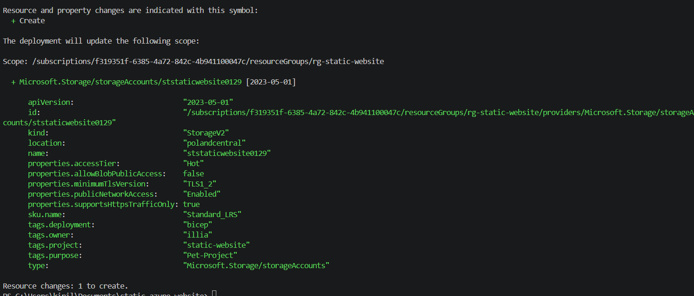
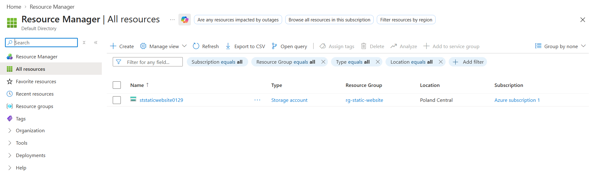
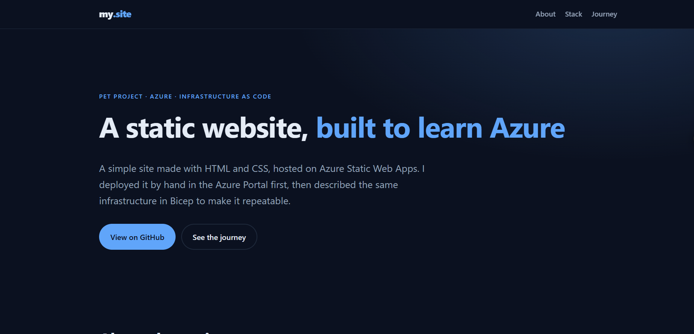
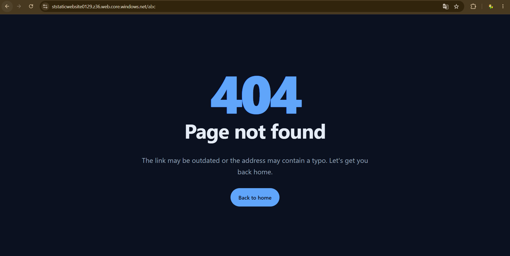

# Deployment using Bicep

The same infrastructure as in the Portal method, now described as code.
Bicep creates the Storage Account, then Azure CLI enables static website hosting and uploads the files.

Why it is done this way → [WHY.md](WHY.md) · Back to [main README](../../README.md)

> Storage account names are globally unique. The Portal and Bicep methods use the same name, so delete the Portal resources before running this deployment.

---

## Project files

```text
infrastructure/bicep/
├── main.bicep          # Storage Account definition
├── main.bicepparam     # Parameter values (name, region, tags)
├── README.md           # Steps (this file)
└── WHY.md              # Explanations
```

---

## Prerequisites

- An [Azure account](https://azure.microsoft.com/free/)
- [Azure CLI](https://learn.microsoft.com/cli/azure/install-azure-cli)
- Bicep tools, installed with the CLI:

```powershell
az --version
az bicep install
az bicep version
```

## Parameters used

| Parameter            | Value                 | Defined in        |
| -------------------- | --------------------- | ----------------- |
| `storageAccountName` | `ststaticwebsite0129` | `main.bicepparam` |
| `location`           | `polandcentral`       | `main.bicepparam` |
| `tags`               | see below             | `main.bicepparam` |
| Resource group       | `rg-static-website`   | CLI command       |

| Tag name     | Value            |
| ------------ | ---------------- |
| `project`    | `static-website` |
| `owner`      | `illia`          |
| `deployment` | `bicep`          |
| `purpose`    | `Pet-Project`    |

---

## Step 1 — Sign in and set variables

```powershell
az login
az account show --query "{name:name, id:id}" -o table
```

```powershell
$RG = "rg-static-website"
$SA = "ststaticwebsite0129"
$LOCATION = "polandcentral"
```

---

## Step 2 — Create the resource group

```powershell
az group create --name $RG --location $LOCATION --tags project=static-website owner=illia deployment=bicep purpose=Pet-Project
```

Expected: `"provisioningState": "Succeeded"`.

---

## Step 3 — Validate the template

Check the syntax (no output means no errors):

```powershell
az bicep build --file infrastructure/bicep/main.bicep --stdout > $null
```

Preview what Azure is going to create:

```powershell
az deployment group what-if --resource-group $RG --parameters infrastructure/bicep/main.bicepparam
```

The output should show one resource to create (`Microsoft.Storage/storageAccounts`).



---

## Step 4 — Deploy the infrastructure

```powershell
az deployment group create --name static-website-deployment --resource-group $RG --parameters infrastructure/bicep/main.bicepparam
```

Expected: `"provisioningState": "Succeeded"` and the outputs `staticWebsiteUrl` and `storageAccountName`.



---

## Step 5 — Grant data access

```powershell
$USER_ID = az ad signed-in-user show --query id -o tsv
$SA_ID = az storage account show --name $SA --resource-group $RG --query id -o tsv

az role assignment create --assignee $USER_ID --role "Storage Blob Data Contributor" --scope $SA_ID
```

No error means the role was assigned.

> The role can take a few minutes to apply. If the next steps return an authorization error, wait and retry.

---

## Step 6 — Enable static website hosting

```powershell
az storage blob service-properties update --account-name $SA --static-website --index-document index.html --404-document 404.html --auth-mode login
```

Check that the `$web` container exists:

```powershell
az storage container list --account-name $SA --auth-mode login -o table
```

---

## Step 7 — Upload the website files

Run from the repository root:

```powershell
az storage blob upload-batch --account-name $SA --destination '$web' --source ./src --overwrite --auth-mode login
```

The contents of `src/` land in the root of `$web`:

```text
$web/
├── index.html
├── style.css
└── 404.html
```

---

## Step 8 — Get the website URL

```powershell
az storage account show --name $SA --resource-group $RG --query "primaryEndpoints.web" -o tsv
```

---

## Step 9 — Verify the deployment

- [x] Resource group was created
- [x] Deployment finished with `Succeeded`
- [x] Tags are present on the storage account
- [x] `$web` container exists
- [x] Files are in the root of `$web`
- [x] Primary endpoint opens in a browser
- [x] HTTPS padlock is shown

```powershell
az storage account show --name $SA --resource-group $RG --query tags
Invoke-WebRequest -Uri https://ststaticwebsite0129.z36.web.core.windows.net/ -Method Head
```

Expected: the four tags and `StatusCode : 200`.



Open a non-existing address (for example `/abc`) to see the custom `404.html`.



---

## Step 10 — Update the website

```powershell
az storage blob upload-batch --account-name $SA --destination '$web' --source ./src --overwrite --auth-mode login
```

Then hard refresh the browser (`Ctrl+Shift+R`).

---

## Step 11 — Clean up (optional)

```powershell
az group delete --name $RG --yes --no-wait
```
