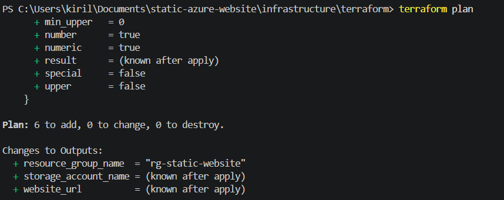
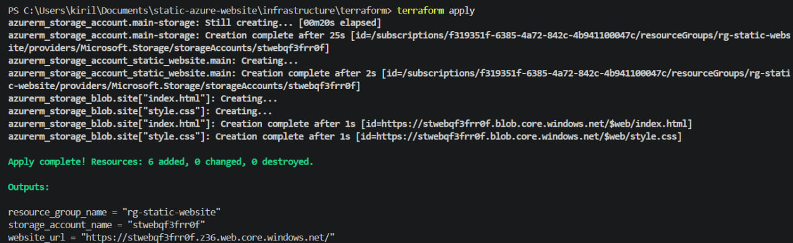
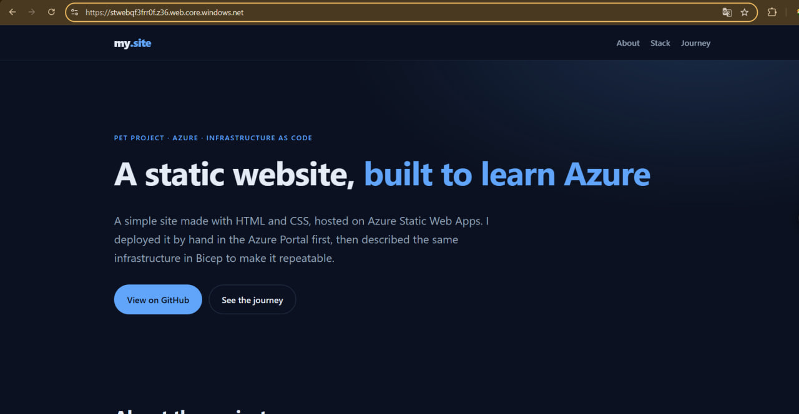
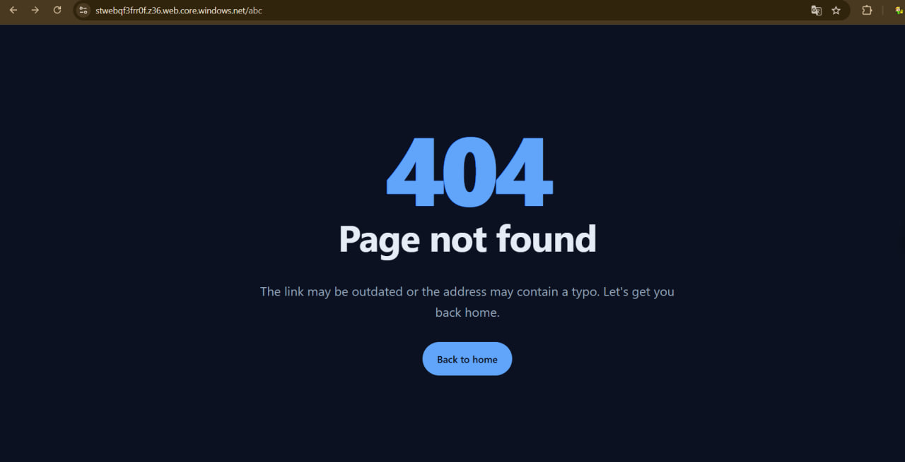
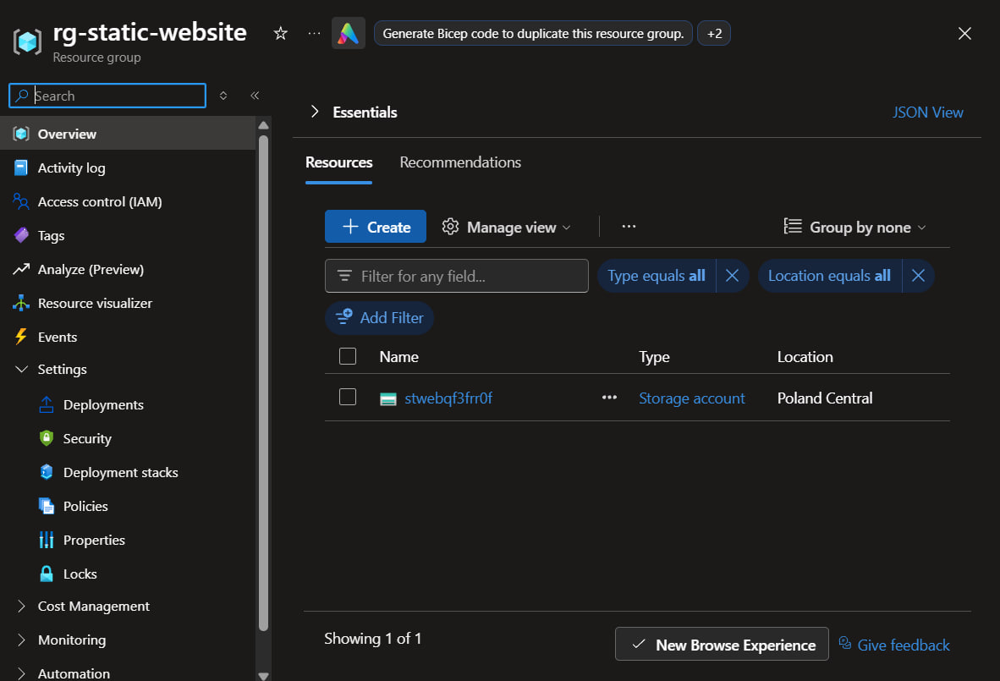

# Deployment using Terraform

The same infrastructure as in the Portal and Bicep methods, described with Terraform.
Unlike Bicep, Terraform does **everything** in one configuration: creates the resources, enables static website hosting and uploads the files.

Why it is done this way → [WHY.md](WHY.md) · Back to [main README](../../README.md)

> Use one method at a time. Delete the Portal or Bicep resources before running Terraform.

---

## Project files

```text
infrastructure/terraform/
├── main.tf                    # Provider, resources, locals
├── variables.tf               # Input variables
├── outputs.tf                 # Values shown after apply
├── terraform.tfvars.example   # Example values (copy to terraform.tfvars)
├── .terraform.lock.hcl        # Locked provider versions (commit it)
├── README.md                  # Steps (this file)
└── WHY.md                     # Explanations
```

Not in Git (see `.gitignore`): `terraform.tfvars`, `.terraform/`, `terraform.tfstate*`.

---

## What Terraform creates

| # | Resource                                   | Purpose                                      |
| - | ------------------------------------------ | -------------------------------------------- |
| 1 | `random_string.suffix`                     | Random part of the storage account name      |
| 2 | `azurerm_resource_group.rg`                | Resource group                               |
| 3 | `azurerm_storage_account.main-storage`     | Storage account                              |
| 4 | `azurerm_storage_account_static_website.main` | Enables static website, creates `$web`    |
| 5 | `azurerm_storage_blob.site` (one per file) | Uploads `index.html`, `style.css`, `404.html` |

---

## Prerequisites

- An [Azure account](https://azure.microsoft.com/free/)
- [Azure CLI](https://learn.microsoft.com/cli/azure/install-azure-cli)
- [Terraform](https://developer.hashicorp.com/terraform/install)

```powershell
az --version
terraform -version
```

---

## Variables

| Variable              | Required | Example                | Purpose                         |
| --------------------- | -------- | ---------------------- | ------------------------------- |
| `subscription_id`     | yes      | `0000...0000`          | Azure subscription              |
| `location`            | yes      | `polandcentral`        | Azure region                    |
| `resource_group_name` | yes      | `rg-static-website`    | Name of the resource group      |
| `environment`         | no       | `dev` (default)        | Value of the `environment` tag  |

---

## Step 1 — Sign in

```powershell
az login
az account show --query "{name:name, id:id}" -o table
```

Copy the `id`, it is your subscription ID.

---

## Step 2 — Create `terraform.tfvars`

Go to the Terraform folder and copy the example:

```powershell
cd infrastructure\terraform
Copy-Item terraform.tfvars.example terraform.tfvars
```

Open `terraform.tfvars` and put your real subscription ID:

```hcl
# Azure
subscription_id = "<your-subscription-id>"
location        = "polandcentral"

# Project
resource_group_name = "rg-static-website"
environment         = "dev"
```

> `terraform.tfvars` is ignored by Git, so your subscription ID is not published.

---

## Step 3 — Initialize

All Terraform commands run from `infrastructure/terraform/`.

```powershell
terraform init
```

Downloads the `azurerm` and `random` providers. Expected: `Terraform has been successfully initialized!`

---

## Step 4 — Format and validate

```powershell
terraform fmt
terraform validate
```

Expected: `Success! The configuration is valid.`

---

## Step 5 — Preview the changes

```powershell
terraform plan
```

Terraform lists what it is going to create. Expected: `Plan: 7 to add, 0 to change, 0 to destroy.`
(random string, resource group, storage account, static website, 3 blobs)



---

## Step 6 — Deploy

```powershell
terraform apply
```

Type `yes` to confirm. After it finishes, Terraform prints the outputs:



| Output                 | Meaning                         |
| ---------------------- | ------------------------------- |
| `website_url`          | Address of the website          |
| `storage_account_name` | Generated storage account name  |
| `resource_group_name`  | Name of the resource group      |

Show them again at any time:

```powershell
terraform output
terraform output website_url
```

---

## Step 7 — Verify the deployment

- [x] `terraform apply` finished without errors
- [x] `website_url` opens in a browser
- [x] HTTPS padlock is shown
- [x] Styles are applied
- [x] A non-existing address (for example `/abc`) shows the custom `404.html`

```powershell
Invoke-WebRequest -Uri (terraform output -raw website_url) -Method Head
```

Expected: `StatusCode : 200`.



Open a non-existing address (for example `/abc`) to see the custom `404.html`.



Open **Resource group → Overview** in the Azure Portal and check the created resources.



---

## Step 8 — Update the website

Edit the files in `src/` and run again:

```powershell
terraform apply
```

Terraform compares the MD5 hash of every file and re-uploads only the changed ones.
Then hard refresh the browser (`Ctrl+Shift+R`).

To add a new file, add it to `site_files` in `main.tf` together with its content type.

---

## Step 9 — Clean up (optional)

```powershell
terraform destroy
```

Type `yes` to confirm. Terraform deletes everything it created.

---

## Commands cheat sheet

| Command              | What it does                                  |
| -------------------- | --------------------------------------------- |
| `terraform init`     | Download providers, prepare the folder        |
| `terraform fmt`      | Format the code                               |
| `terraform validate` | Check the syntax                              |
| `terraform plan`     | Preview changes, creates nothing              |
| `terraform apply`    | Create or update resources                    |
| `terraform output`   | Show output values                            |
| `terraform destroy`  | Delete all resources                          |

Override a value once without editing the file:

```powershell
terraform plan -var="location=westeurope"
```